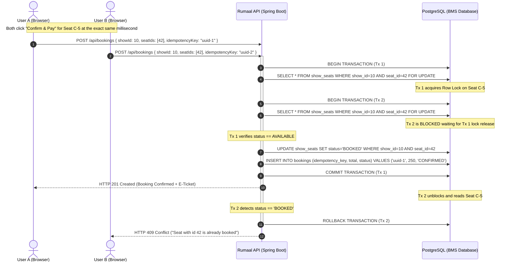
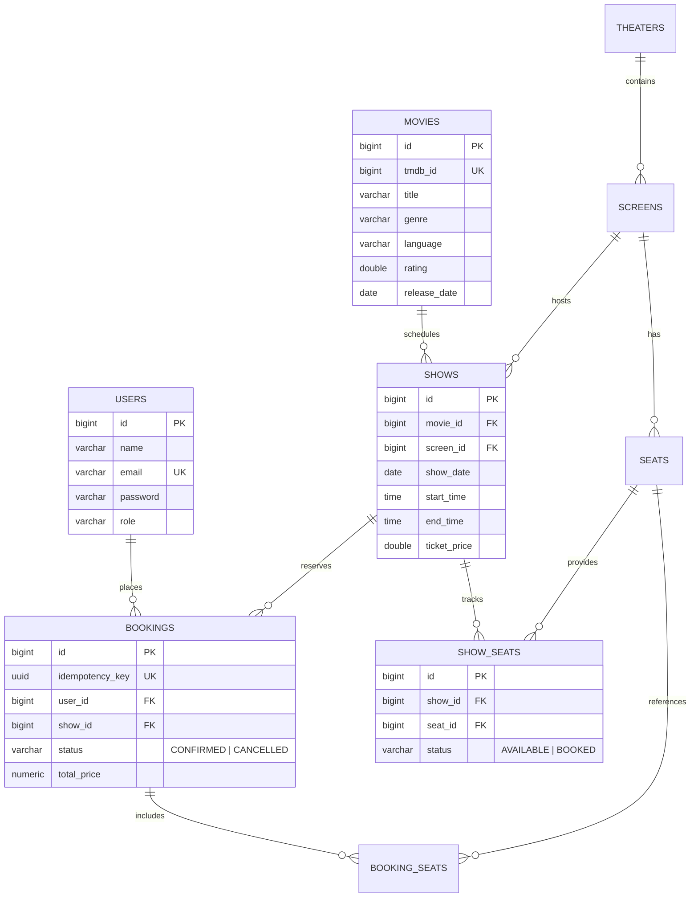

# Rumaal (रूमाल) — Concurrency-Safe Live Movie Ticket Booking Platform

[](https://spring.io/projects/spring-boot)
[](https://www.oracle.com/java/)
[](https://www.postgresql.org/)
[](https://react.dev/)
[](https://vitejs.dev/)
[](https://flywaydb.org/)
[](https://www.themoviedb.org/)

> *In India, placing your **rumaal** (handkerchief) on a seat means it's indisputably reserved. **Rumaal** brings that same definitive, instant reservation guarantee to digital cinema ticketing — completely eliminating race conditions, double-bookings, and checkout surprises.*

---

## Overview

**Rumaal** is a production-grade, full-stack movie ticketing platform built from the ground up to solve the hardest problem in ticketing: **concurrency-safe seat inventory under extreme flash-sale load**.

Traditional booking applications suffer from *check-then-act* race conditions where two simultaneous users can select and pay for the same seat at the exact same millisecond. Rumaal eliminates this with a dedicated per-show inventory ledger, PostgreSQL row-level pessimistic locking (`PESSIMISTIC_WRITE`), database uniqueness constraints, and strict idempotency handling.

The system is paired with real-time theatrical synchronization via **The Movie Database (TMDB) API**, pulling live in-theatre releases, authentic cast & crew, posters, and generating conflict-free show schedules across screens.

---

## Key Features

### 1. Concurrency-Safe Booking Engine
- **Per-Show Seat Ledger (`show_seats`)**: Every show maps its screen seats into an inventory table with atomic status tracking (`AVAILABLE`, `BOOKED`).
- **Pessimistic Write Locks**: Concurrent booking attempts acquire `PESSIMISTIC_WRITE` (`SELECT ... FOR UPDATE`) locks on candidate seat rows within an active database transaction.
- **Database-Enforced Uniqueness**: `UNIQUE(show_id, seat_id)` constraint ensures the database itself is the ultimate arbiter against double bookings.
- **Idempotency Key Tracking**: Reusing or retrying booking requests with the same `Idempotency-Key` (header or payload) safely retrieves the original confirmed reservation without duplicate charges or orphaned seats.
- **Seat Release on Cancellation**: Cancelling a booking instantly reverts seat statuses in `show_seats` back to `AVAILABLE`.

### 2. Live TMDB Theatrical Synchronization
- **Real-Time Now-Playing Feed**: Synchronizes movies currently running in theatres worldwide (defaults to Indian theatrical releases `region=IN`, supports Hollywood/global releases).
- **Automated Startup Sync**: Background event listener triggers non-blocking synchronization on application boot when an API key is configured.
- **Overlap-Free Show Scheduling**: Analyzes existing schedules on assigned screens to ensure 2.5-hour show intervals `[startTime, endTime)` never collide or overlap across any title.
- **Duplicate Prevention**: Tracks TMDB IDs via database column `tmdb_id BIGINT UNIQUE` with seamless fallback to normalized title matching.
- **Finite Network Timeouts**: Outbound HTTP requests use `SimpleClientHttpRequestFactory` with strict 10-second connection and 15-second read deadlines.

### 3. Production Security & Data Isolation
- **Authentication**: Stateless JWT access tokens with BCrypt-12 password hashing.
- **Strict Principal Ownership Checks**:
  - `POST /api/bookings`: Automatically derives the booking user ID from the authenticated Spring Security `Principal` (ignoring spoofed payload IDs).
  - `GET /api/bookings/{id}`, `GET /api/bookings/user/{userId}`, and `PUT /api/bookings/{id}/cancel`: Rejects unauthorized access with HTTP 403 `AccessDeniedException` unless the requester owns the record or holds the `ADMIN` role.
- **Sensitive Field Sanitization**: Sensitive user attributes (`password`, `phone`, `role`) are protected via Jackson serialization controls and never exposed in booking payloads.
- **RFC 7807 Problem Details**: Structured error formats with canonical machine-readable URI types and clear diagnostic messages.

### 4. Modern React 19 Frontend Experience
- **Cinematic Dark Theme**: Responsive glassmorphism UI styled with Tailwind-grade CSS variables and smooth transitions.
- **Interactive Multi-Filter System**: Filter by search terms, languages, and genres with tokenized multi-genre parsing.
- **Live Seat Matrix**: Interactive theater layout supporting Regular, Premium, and VIP seat tiers with live occupied/available state tracking.
- **Digital Boarding Pass & QR Pass**: Scannable ticket passes generated dynamically for cinema turnstile check-in.
- **Transparent Payment Sandbox**: Clear test-mode simulation indicating zero real payment processing or raw credential collection.

---

## Architecture & Concurrency Model



---

## Database Schema



---

## REST API Reference

Base path: `/api` (or versioned `/api/v1`). Interactive Swagger UI documentation is available at `http://localhost:8080/swagger-ui/index.html`.

### Authentication & Users
| Method | Endpoint | Access | Description |
|---|---|---|---|
| `POST` | `/api/users/register` | Public | Register a new user (`name`, `email`, `password` ≥ 8 chars) |
| `POST` | `/api/users/login` | Public | Authenticate user credentials and receive JWT access token |
| `GET` | `/api/users/{id}` | Admin / Self | Retrieve user profile (never leaks password or sensitive fields) |

### Movies & Live Theatrical Catalog
| Method | Endpoint | Access | Description |
|---|---|---|---|
| `GET` | `/api/movies` | Public | Paginated list of movies (sorted by latest release date) |
| `GET` | `/api/movies/{id}` | Public | Movie details by ID |
| `GET` | `/api/movies/search?title=` | Public | Search titles using PostgreSQL trigram fuzzy matching |
| `GET` | `/api/movies/genre/{genre}` | Public | Filter movies by genre |
| `GET` | `/api/movies/language/{lang}` | Public | Filter movies by audio language |
| `POST` | `/api/movies/sync-tmdb` | Authenticated | Trigger synchronization of now-playing theatrical releases from TMDB |
| `GET` | `/api/movies/tmdb-status` | Public | Check if backend TMDB API integration is active |

### Theaters, Screens & Shows
| Method | Endpoint | Access | Description |
|---|---|---|---|
| `GET` | `/api/theaters` | Public | List theaters (filter by `/city/{cityId}`) |
| `GET` | `/api/shows` | Public | List scheduled shows |
| `GET` | `/api/shows/movie/{movieId}` | Public | Showtimes and theater groupings for a movie |
| `GET` | `/api/seats/screen/{screenId}`| Public | Physical screen seat layout and tiers |

### Bookings (Concurrency-Safe)
| Method | Endpoint | Access | Description |
|---|---|---|---|
| `GET` | `/api/bookings/show/{showId}/available-seats` | Public | Live available seat IDs for a given show |
| `POST` | `/api/bookings` | Authenticated | Create a booking with idempotent retries (`Idempotency-Key` supported) |
| `GET` | `/api/bookings/{id}` | Authenticated (Owner/Admin) | Retrieve e-ticket booking pass |
| `GET` | `/api/bookings/user/{userId}` | Authenticated (Owner/Admin) | Paginated history of reservations for current user |
| `PUT` | `/api/bookings/{id}/cancel` | Authenticated (Owner/Admin) | Cancel reservation and release seats back to inventory |

---

## Getting Started

### Prerequisites
- **Java**: OpenJDK 21 or higher
- **Build Tool**: Apache Maven 3.9+ (or included `./mvnw`)
- **Database**: PostgreSQL 15+ (or Docker)
- **Node.js**: v18+ and npm

---

### 1. Database Setup
Start PostgreSQL locally or using Docker:

```bash
# Using Docker
docker run -d --name rumaal-postgres \
  -e POSTGRES_DB=BMS \
  -e POSTGRES_USER=postgres \
  -e POSTGRES_PASSWORD=123 \
  -p 5432:5432 \
  postgres:16-alpine
```

---

### 2. Backend Configuration & Startup

Configure your database and secrets in `src/main/resources/application.properties` or via environment variables:

```properties
# Database
spring.datasource.url=jdbc:postgresql://localhost:5432/BMS
spring.datasource.username=postgres
spring.datasource.password=123

# Security (Set 64+ char random secret in production)
app.jwt.secret=c3VwZXItc2VjdXJlLWJvb2steW91ci1zaG93LWp3dC1rZXktZm9yLXRlc3RpbmctcHVycG9zZXMtb25seQ==
app.jwt.expiration-ms=604800000

# TMDB Real-Time Synchronization (Optional for live in-theatre releases)
app.tmdb.api-key=YOUR_TMDB_API_READ_TOKEN_OR_V3_KEY
app.tmdb.region=IN
```

Run database migrations and launch the backend:

```bash
# Windows
.\mvnw.cmd spring-boot:run

# Linux / macOS
./mvnw spring-boot:run
```

The Spring Boot backend will start on **`http://localhost:8080`**.
Flyway will automatically execute database migrations (`V1__baseline.sql`, `V2__add_tmdb_id.sql`).

---

### 3. Frontend Setup & Startup

```bash
cd frontend
npm install
npm run dev
```

The client application will start at **`http://localhost:5173`**.

---

## Concurrency Verification Test

Rumaal includes an automated high-contention test verifying that simultaneous requests for the same seat cannot cause duplicate bookings:

```bash
# Run isolated concurrency integration test
.\mvnw.cmd test -Dtest=BookingConcurrencyTest
```

**How it works**:
1. Spawns two concurrent threads targeting the exact same `(show_id, seat_id)`.
2. Asserts that exactly **one** thread receives HTTP 201 (`CONFIRMED`).
3. Asserts that the competing thread fails with HTTP 409 (`SeatAlreadyBookedException`).
4. Verifies database state contains exactly 1 booking row for the seat.

---

## Configuration Reference

| Environment Variable | Default Value | Description |
|---|---|---|
| `SPRING_DATASOURCE_URL` | `jdbc:postgresql://localhost:5432/BMS` | PostgreSQL JDBC connection URL |
| `SPRING_DATASOURCE_USERNAME` | `postgres` | Database username |
| `SPRING_DATASOURCE_PASSWORD` | `123` | Database password |
| `APP_JWT_SECRET` | *Dev default* | 256-bit secret key for signing JWTs |
| `APP_JWT_EXPIRATION_MS` | `604800000` (7 Days) | Token expiration duration in milliseconds |
| `APP_TMDB_API_KEY` | *(Empty)* | TMDB Read Access Token or v3 API Key |
| `APP_TMDB_REGION` | `IN` | Theatrical region code for now-playing sync (`IN`, `US`, `GB`) |
| `CORS_ALLOWED_ORIGINS` | `http://localhost:5173` | Permitted browser frontend origins |

---

## Docker Deployment

Build and run Rumaal as a container:

```bash
# Build Docker image
docker build -t rumaal:latest .

# Run container connected to host database
docker run -p 8080:8080 \
  -e SPRING_DATASOURCE_URL=jdbc:postgresql://host.docker.internal:5432/BMS \
  -e SPRING_DATASOURCE_USERNAME=postgres \
  -e SPRING_DATASOURCE_PASSWORD=123 \
  -e APP_JWT_SECRET=production_secret_key_minimum_32_bytes_long \
  -e APP_TMDB_API_KEY=your_tmdb_key \
  rumaal:latest
```

---

## License

Distributed under the MIT License. See `LICENSE` for more information.
